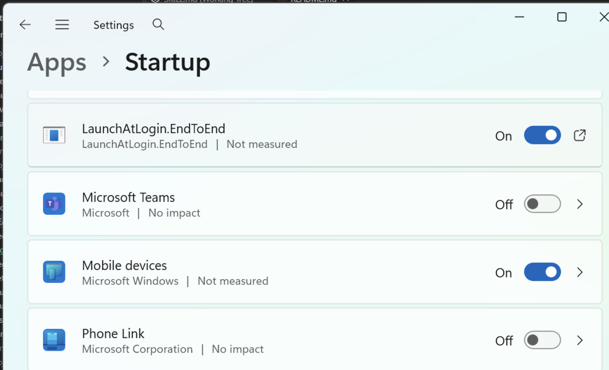
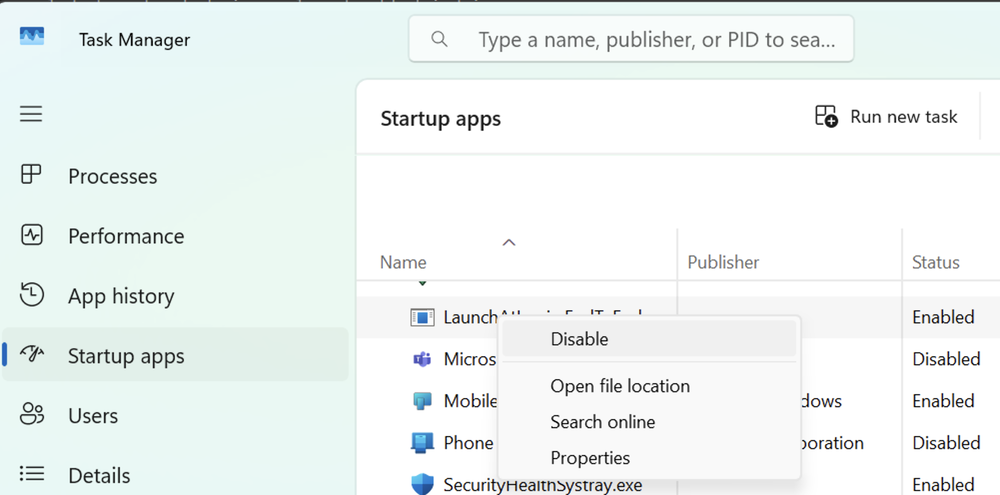

# End-to-end test

The unit tests use a fake registry, so they can't prove that Windows actually launches the app at login.
This test uses a real startup entry, by having you log out and back in twice.

It checks three things:

1. A startup app that's turned on launches at login.
1. After `TurnOff()`, the way Task Manager turns an app off, it doesn't launch at login.
1. The registry values that `StartupApp`, Settings, and Task Manager write match [registry-snapshots.json](registry-snapshots.json).

The unit tests use the same `registry-snapshots.json` recording, so the fake registry can't drift from what Windows really stores.

It isn't part of `build-and-test.cmd` because it needs a person to log out and back in.

## Running it

It uses your real startup apps, under the name `LaunchAtLogin.EndToEnd`.
It removes itself when it finishes, passes or fails.

1. Run `dotnet run --project LaunchAtLogin.EndToEnd -- manual`.
   It turns itself on as a startup app.
1. It turns itself off and on in `Settings` > `Apps` > `Startup`, using UI Automation.
   If it can't find the switch, it asks you to flip it.

   

1. It opens Task Manager and asks you to Disable, then Enable, it in Startup apps.

   

1. Log out and back in.
   It should open by itself and say `Stage 1 PASS`.
   It then turns itself off.
1. Log out and back in again.
   It should *not* open by itself.
1. Run `dotnet run --project LaunchAtLogin.EndToEnd -- manual` again.
   It should say `PASS`.

If it doesn't open at step 2, run the command yourself to see the failure.

## Registry snapshots

After each change, it reads the app's values in the `Run` and `StartupApproved` registry keys and compares them to [registry-snapshots.json](registry-snapshots.json).
The exe path and timestamp bytes are masked, so they match from run to run.
A mismatch fails the test.

If Windows' behavior really changed, or to record for the first time, start with `manual --accept`.
That writes the actual values into the file instead of comparing.
Review the diff before committing it.

Unit tests skip any snapshot that isn't recorded yet.

## How it knows what happened

- **Launched at login, or by you:** the startup entry runs the exe with no arguments.
  That's why you always pass `manual`.
- **Which stage it's in:** a progress file in `%TEMP%` holds the stage and when it started.
- **Whether you've logged in since:** it checks that Explorer started after the stage did.

## If something goes wrong

Run it with `manual` before logging out to see the current stage, the startup command, and whether it's on.
Type `reset` there to remove it from your startup apps and start over.

If Explorer crashes and restarts during a stage, the test may think you've logged in.
Reset and start again.
